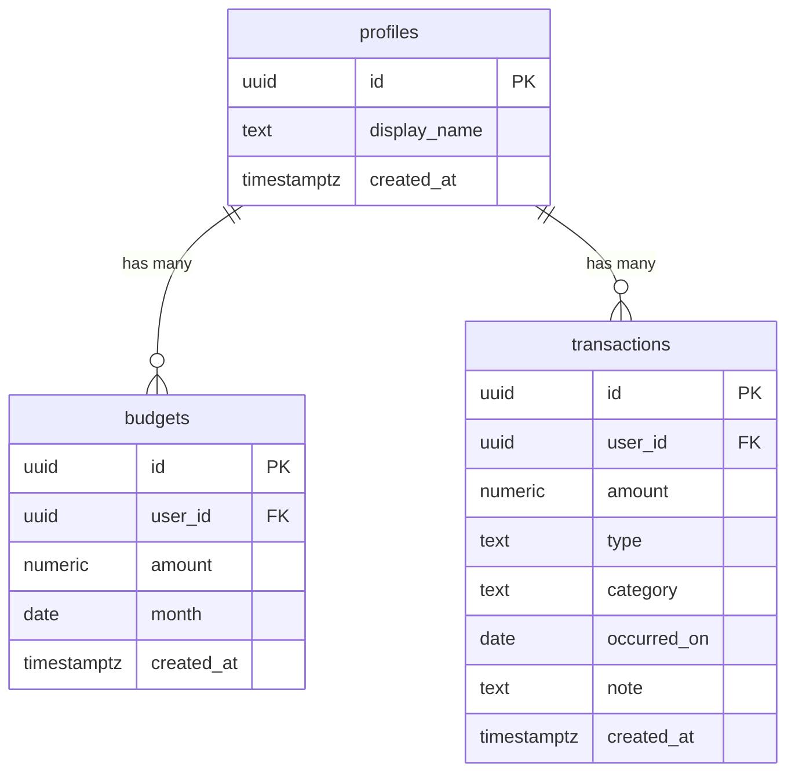

# Penny Pal Database Diagram

This diagram shows the three tables and how they connect. GitHub renders the
Mermaid block below as a picture.

Reading it: one person (profiles) can have many budgets and many transactions.
Each budget and each transaction belongs to exactly one person, linked by
`user_id`. `PK` means the row's own unique id; `FK` means a link to the owner.
